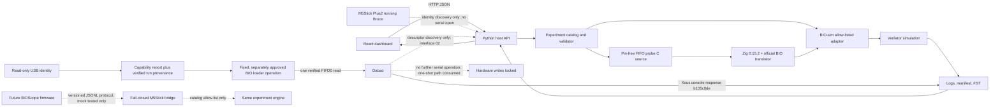

# BIOScope Architecture

```text
Dabao board --USB-->                    +---------------------+
                                        |                     |
M5Stick Plus2 --USB--> Manjaro PC ------| Python host bridge  |
                                        | discovery/adapters  |
                                        | run orchestration   |
                                        +-----+-----------+---+
                                              |           |
                                         BIO-sim       Local API
                                         C source      HTTP/events
                                         Verilator         |
                                         toolchain         v
                                              |       React + TS
                                         logs/FST      dashboard
```

Both boards connect independently to the host; no direct board link is assumed. A one-time approved Dabao FIFO0 probe is now recorded as genuine `HARDWARE_VERIFIED` evidence. The M5Stick still has Bruce and is not connected to BIOScope's operator protocol.

## Current data flow



M5Stick transport framing is prepared for a separately installed BIOScope firmware, but the connected device is operator-associated with Bruce firmware. Bruce has a different, broad serial command interface; BIOScope does not open the M5Stick port or run its bridge against Bruce. The M5Stick opener raises `PhysicalSerialDisabled` after identity preflight; mock transports exercise the bounded protocol and allow-listed catalog handler. The Dabao's one approved console session is recorded in the physical run manifest and the port is closed. Background USB identity discovery uses exact VID/PID + serial + physical topology plus the persistent by-id link and does not open either port.

## Components
- BIO-sim adapter: wraps official upstream build/run scripts, captures command, exit code, logs, versions, revision and artifacts.
- Dabao adapter: evidence-based discovery; documented console/loader only; writes gated by approval.
- M5Stick adapter: verified USB identity, versioned bounded mock protocol, catalog-only run requests; physical serial is fail-closed while Bruce is installed.
- Python host: device discovery, experiment registry, run orchestration, API, logs and artifact index.
- Dashboard: React + TypeScript + Vite; Overview, Devices, Experiments, Runs, Waveforms/Artifacts, Logs, Diagnostics.
- M5Stick UI: status, host link, experiment menu, progress, result, errors.
- Device discovery: read-only sysfs/interface-driver plus `/dev/serial/by-id` inspection; per-profile matching requires VID/PID, unique USB serial and recorded topology. Dashboard status refreshes every 2 seconds.

The current host API is `apps/host/server.py`; `/api/hardware/capabilities` presents identity and upstream path state without opening a port. The typed React dashboard is `apps/dashboard/src/`. The simulator adapter supports fixed catalog entries/configs and never accepts arbitrary commands. The pin-free FIFO probe is compiled by `scripts/build-dabao-bio-probe.py`, then run in BIO-sim as separate `SIMULATED` evidence. Runs retain a JSON manifest, separate stdout/stderr and copied artifacts under `artifacts/runs/<run_id>/`. Current M5Stick frames are a prepared protocol sketch; there is not yet an active host serial bridge.

The physical Dabao path was exercised once with explicit operator approval. Xous reported `v0.10.1-43-g8964027ff`, tied to inspected source commit `8964027fff25f8b85d3d3c63933d365ac7614523`. The official BIO console accepted the 20-byte probe, committed a padded 0xF00-byte image, reloaded the core, and returned `b105c0de` from FIFO0. Run `d61c047a-8fcc-4b4f-b5f8-f5eb5f2a7a62` records the result, logs, hardware identity and source hashes. The operation replaced the previous stored BIO program; no documented readback/recovery command exists. It touched no GPIO or BAOCHIP update volume. Further hardware runs remain behind the fixed CLI and separate approval.

## Suggested repository layout
```text
bioscope/
├── .agents/skills/bioscope-engineer/SKILL.md
├── apps/dashboard/
├── apps/host/
├── firmware/m5stick-plus2/
├── adapters/{bio_sim,dabao,m5stick}/
├── experiments/{registry,bio}/
├── docs/ plans/ progress/ reports/ scripts/
└── artifacts/                 # ignored by Git
```
Adapt to existing repo; do not overwrite it blindly.

## Suggested API
- GET /api/health
- GET /api/devices
- GET /api/experiments
- POST /api/runs
- GET /api/runs/{run_id}
- GET /api/runs/{run_id}/logs
- GET /api/runs/{run_id}/artifacts
- Optional WebSocket /api/events

Each run records ID, experiment, mode, config hash, source revision, tool versions, timestamps, exit code and evidence.

## Experiment contract
Each experiment declares ID, title, objective, allowed modes (MOCK/SIMULATION/COMPILE_ONLY/HARDWARE), dependencies, input schema, validated command/adapter, outputs, safety class and evidence requirements. Never accept arbitrary shell commands from UI.

## Protocol
Versioned framing with message type, request ID, bounded payload, timeout, explicit errors. Test malformed frames, truncation, duplicate IDs and disconnects. No credentials or private keys in messages.

## Run states
QUEUED -> VALIDATING -> BUILDING -> SIMULATING -> COMPLETED/FAILED.
Hardware path separately: QUEUED -> VALIDATING -> AWAITING_APPROVAL -> RUNNING -> HARDWARE_RESULT_CAPTURED.
A simulator completion is never hardware verification.
