# BIOScope Architecture

```text
Dabao board --USB-->                    +---------------------+
                                        |                     |
M5Stick Plus2 --USB--> Manjaro PC ------| Python host bridge  |
                                        | discovery/adapters  |
                                        | run orchestration   |
                                        +-----+-----------+---+
                                              |           |
                                         BIO-sim       Local API
                                         C source      HTTP/events
                                         Verilator         |
                                         toolchain         v
                                              |       React + TS
                                         logs/FST      dashboard
```

Both boards connect independently to the host over USB. PulseLink adds a proposed low-speed physical signal wire from Dabao BIO1 to Plus2 GPIO32 and a common-ground wire, but neither is installed. The one-time approved Dabao FIFO0 probe is genuine `HARDWARE_VERIFIED` evidence; it is unrelated to PulseLink. The M5Stick still has Bruce and has not sent BIOScope telemetry.

## Current data flow

```mermaid
flowchart LR
  UI[React dashboard] -->|HTTP JSON| API[Python host API]
  API --> REG[Experiment catalog and validator]
  REG --> SIM[BIO-sim allow-listed adapter]
  SIM --> RTL[Verilator simulation]
  RTL --> OUT[Logs, manifest, FST]
  REG --> PROBE[Pin-free FIFO probe C source]
  PROBE --> BIOC[Zig 0.15.2 + official BIO translator]
  BIOC --> SIM
  DISC[Read-only USB identity] --> CAP[Capability report plus verified run provenance]
  CAP --> BIOHW[Fixed, separately approved BIO loader operation]
  BIOHW -->|one verified FIFO0 read| DAB[Dabao]
  DAB -->|Xous console response b105c0de| OUT
  OUT --> API
  API --> UI
  STICK[M5Stick Plus2 running Bruce] -. identity discovery only; no serial open .-> API
  FW[Future BIOScope firmware] -. versioned JSONL protocol, mock tested only .-> BRIDGE[Fail-closed M5Stick bridge]
  BRIDGE -. catalog allow-list only .-> ENG[Same experiment engine]
  DAB -. descriptor discovery only; interface 02 .-> API
  DAB -. no further serial operation; one-shot path consumed .-> GUARD[Hardware writes locked]
  BIOPL[PulseLink BIO1 program<br/>compiled only] -. not uploaded .-> PB1[Dabao header pin 29]
  PB1 -. planned 1 kΩ signal lead .-> GPIO32[Plus2 Grove GPIO32]
  GPIO32 -. only after approved firmware .-> EDGE[interrupt edge telemetry]
  EDGE -. strict JSONL parser; opt-in serial open .-> API
  EDGE -. actual timestamps only after full capture .-> VCD[VCD for GTKWave]
```



The M5Stick device currently runs Bruce. The new PulseLink receiver firmware is compiled but not installed. The host parser validates bounded protocol-v1 telemetry; the optional receiver service opens only the strict stable M5Stick by-id profile and is disabled by default. USB discovery never opens either serial port. Host USB serial open may reset the ESP32; it is not started while Bruce is installed. No M5Stick telemetry or physical PulseLink capture exists yet.

## Components
- BIO-sim adapter: wraps official upstream build/run scripts, captures command, exit code, logs, versions, revision and artifacts.
- Dabao adapter: evidence-based discovery; documented console/loader only; writes gated by approval.
- M5Stick adapters: existing fail-closed mock run-request bridge; separate optional PulseLink telemetry-only receiver with identity-checked by-id discovery and strict JSON validation.
- Python host: device discovery, experiment registry, run orchestration, API, logs and artifact index.
- Dashboard: React + TypeScript + Vite; Overview, Devices, Experiments, Runs, Waveforms/Artifacts, Logs, Diagnostics.
- M5Stick PulseLink firmware: GPIO32 input, edge counter/frequency, local state display and JSON telemetry; compile-only pending approval to replace Bruce.
- PulseLink dashboard: actual received telemetry, actual edge timeline and completed hardware VCD only; simulation evidence is separately labelled.
- Device discovery: read-only sysfs/interface-driver plus `/dev/serial/by-id` inspection; per-profile matching requires VID/PID, unique USB serial and recorded topology. Dashboard status refreshes every 2 seconds.

The host API is `apps/host/server.py`; `/api/pulselink` returns actual telemetry or an explicit disconnected state. The telemetry serial service is disabled unless the host is started with `--enable-pulselink-serial`. The simulator adapter supports the new BIO pulse program using a time-accelerated RTL configuration. Physical PulseLink start controls remain unavailable. Complete clean hardware captures produce a VCD from actual M5Stick interrupt timestamps; the trace is a low-rate GPIO edge record, not a high-resolution logic analyzer or an FST.

The physical Dabao path was exercised once with explicit operator approval. Xous reported `v0.10.1-43-g8964027ff`, tied to inspected source commit `8964027fff25f8b85d3d3c63933d365ac7614523`. The official BIO console accepted the 20-byte probe, committed a padded 0xF00-byte image, reloaded the core, and returned `b105c0de` from FIFO0. Run `d61c047a-8fcc-4b4f-b5f8-f5eb5f2a7a62` records the result, logs, hardware identity and source hashes. The operation replaced the previous stored BIO program; no documented readback/recovery command exists. It touched no GPIO or BAOCHIP update volume. Further hardware runs remain behind the fixed CLI and separate approval.

## Suggested repository layout
```text
bioscope/
├── .agents/skills/bioscope-engineer/SKILL.md
├── apps/dashboard/
├── apps/host/
├── firmware/m5stick-plus2/
├── adapters/{bio_sim,dabao,m5stick}/
├── experiments/{registry,bio}/
├── docs/ plans/ progress/ reports/ scripts/
└── artifacts/                 # ignored by Git
```
Adapt to existing repo; do not overwrite it blindly.

## Suggested API
- GET /api/health
- GET /api/devices
- GET /api/experiments
- POST /api/runs
- GET /api/runs/{run_id}
- GET /api/runs/{run_id}/logs
- GET /api/runs/{run_id}/artifacts
- Optional WebSocket /api/events

Each run records ID, experiment, mode, config hash, source revision, tool versions, timestamps, exit code and evidence.

## Experiment contract
Each experiment declares ID, title, objective, allowed modes (MOCK/SIMULATION/COMPILE_ONLY/HARDWARE), dependencies, input schema, validated command/adapter, outputs, safety class and evidence requirements. Never accept arbitrary shell commands from UI.

## Protocol
Versioned framing with message type, request ID, bounded payload, timeout, explicit errors. Test malformed frames, truncation, duplicate IDs and disconnects. No credentials or private keys in messages.

## Run states
QUEUED -> VALIDATING -> BUILDING -> SIMULATING -> COMPLETED/FAILED.
Hardware path separately: QUEUED -> VALIDATING -> AWAITING_APPROVAL -> RUNNING -> HARDWARE_RESULT_CAPTURED.
A simulator completion is never hardware verification.
