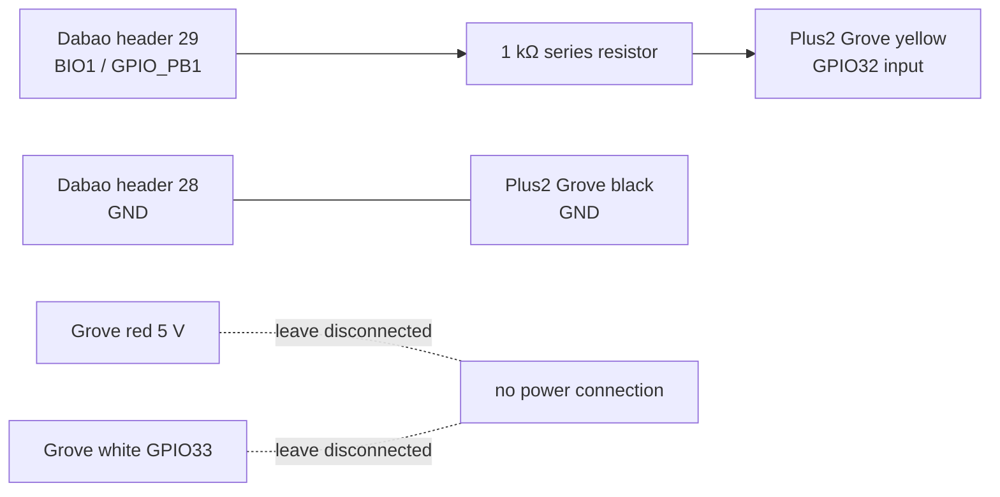

# PulseLink wiring and electrical checks

## Verified pin mapping

The official Dabao pinout maps header **pin 29** to `GPIO_PB1` and `BIO1`; header **pin 28** is GND. The exact Xous revision used by the verified Dabao is `8964027fff25f8b85d3d3c63933d365ac7614523`; its BIO loader maps the selected BIO bit to the pad through the Xous HAL. The program's BIO output mask bit is 1.

The M5Stack Plus2 documentation maps the Grove HY2.0-4P cable as black GND, red 5 V, yellow GPIO32, white GPIO33. GPIO32 is exposed as an external pin and is the receiver input used by the firmware.

| Source | Connection | Receiver | Notes |
|---|---|---|---|
| Dabao header pin 29, `BIO1 / GPIO_PB1` | 1 kΩ series resistor, in signal path | M5Stick Plus2 Grove yellow, GPIO32 | Digital signal only |
| Dabao header pin 28, GND | direct ground wire | M5Stick Plus2 Grove black, GND | Common reference |
| Dabao/M5 5 V | **no connection** | Grove red 5 V | Leave disconnected |
| Dabao other pins | **no connection** | Grove white GPIO33 | Leave disconnected |

The boards remain independently USB-powered from the host. Do not connect either board's 5 V or 3.3 V supply rail to the other board.

## Voltage compatibility and what remains to measure

Xous's Baochip console documentation says Dabao I/O is at VDDIO and that Dabao uses **3.3 V**. M5Stack identifies the Plus2 SoC as ESP32-PICO-V3-02; Espressif's GPIO guidance gives a maximum input of **3.6 V**. The documented nominal logic levels are therefore compatible (3.3 V below 3.6 V). GPIO32 is a digital input; it is not being used as an analog measurement.

The actual PulseLink output has **not** been run or measured yet. Before attaching the M5Stick signal input, a separate approved Dabao run must first establish the unloaded output waveform and verify its LOW/HIGH levels against ground. Use a high-impedance meter with min/max or an oscilloscope. If the measured HIGH can exceed 3.6 V, or the measurement is ambiguous, do not connect the boards; add a verified level interface and review it first. The 1 kΩ resistor is additional series fault-current limitation, not a level shifter and not a substitute for measurement.

## Checklist

### Before any wiring

- [ ] Keep both boards unpowered and USB disconnected while wiring/continuity-checking.
- [ ] Confirm the Dabao board pin-1 orientation from its silkscreen and official board drawing; count to pins 29 and 28 from the documented pinout.
- [ ] Confirm the Plus2 is the Plus2 revision and use its Grove connector, not similarly named pins on another StickC revision.
- [ ] Confirm a 1 kΩ resistor is in series with the signal lead.
- [ ] Continuity-check the wire path through the resistor; verify there is no short between signal and ground or either power rail.
- [ ] Confirm Grove red 5 V and white GPIO33 are unconnected.

### Before joining signal to GPIO32

- [ ] Obtain the required separate authorization for BIO upload/keystore changes and physical run.
- [ ] Run the Dabao generator with the M5Stick signal wire still disconnected.
- [ ] Measure the output between Dabao header pin 29 and pin 28: confirm LOW near 0 V, HIGH no greater than 3.3 V nominal and in all cases below 3.6 V, and confirm 1 Hz / ten rising edges / final LOW.
- [ ] Stop the run or wait until the BIO program has completed and is holding LOW.
- [ ] Power down both boards before attaching the signal and common-ground wires.
- [ ] Recheck continuity and that neither supply pin is connected.
- [ ] Power independently over USB; inspect the input with no generator active before starting the separately approved physical run.

Do not connect the proposed wiring yet: actual output-level measurement requires the not-yet-approved BIO upload and run. No board-to-board wire is installed or assumed.

## Source references

- [Baochip Dabao official pinout](https://github.com/baochip/dabao/tree/main/docs/pinout)
- [Baochip Dabao v3c schematic](https://github.com/baochip/dabao/blob/main/dabao_v3c.kicad_sch)
- [Pinned Xous console electrical-level note](https://github.com/betrusted-io/xous-core/blob/8964027fff25f8b85d3d3c63933d365ac7614523/README-consoles.md)
- [Pinned Xous BIO loader](https://github.com/betrusted-io/xous-core/blob/8964027fff25f8b85d3d3c63933d365ac7614523/apps-dabao/dabao-console/src/cmds/bio.rs)
- [Pinned Xous I/O HAL mapping](https://github.com/betrusted-io/xous-core/blob/8964027fff25f8b85d3d3c63933d365ac7614523/libs/bao1x-hal/src/iox.rs)
- [M5StickC Plus2 pin map](https://docs.m5stack.com/en/core/StickC-Plus2)
- [Espressif GPIO voltage guidance](https://docs.espressif.com/projects/esp-faq/en/latest/esp-faq-en-master.pdf)
